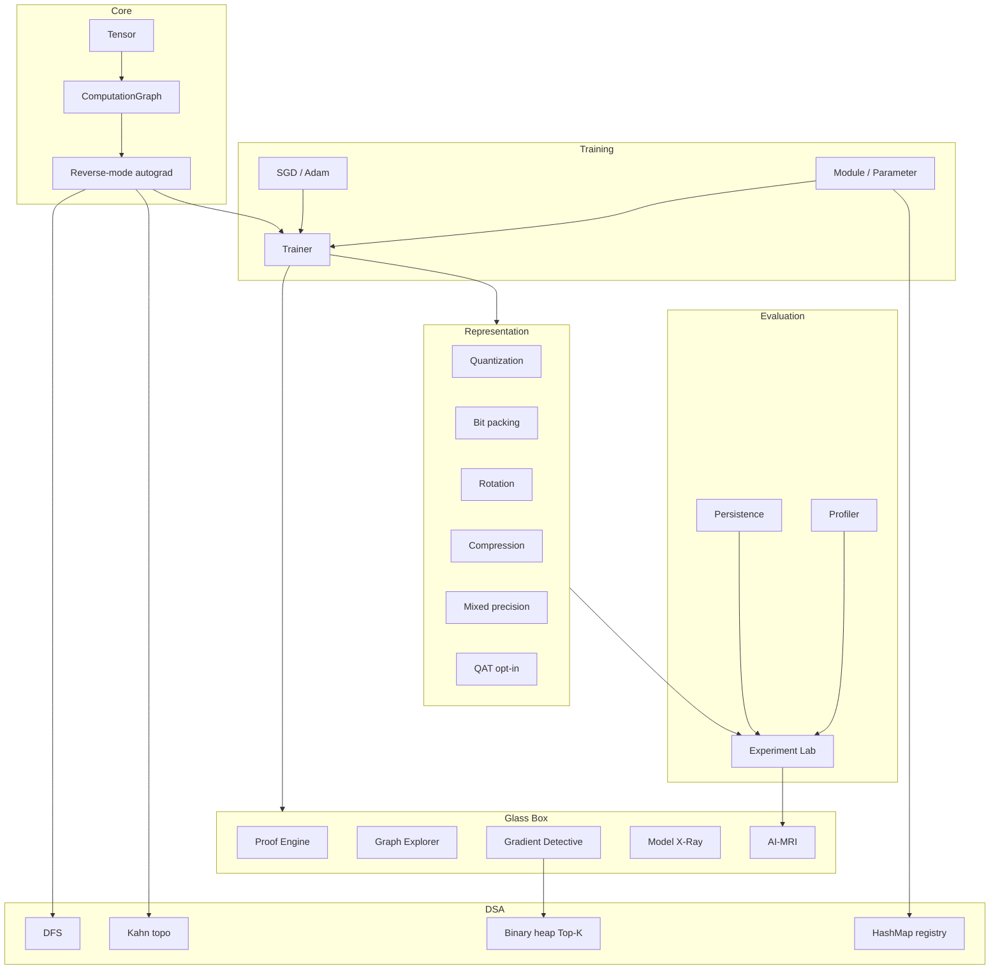

# Architecture

MiniTorch is a **Glass Box** autodiff stack. The computational graph is a real
DAG. Inspection, compression, and experiments compose existing systems instead
of inventing parallel copies.

Package-level file map: [`docs/architecture.md`](docs/architecture.md).  
Measured evaluation: [`docs/final_report.md`](docs/final_report.md).

## System



## Data flow

```text
Dataset -> Trainer.train_step
        -> zero_grad -> forward -> loss -> backward -> optimizer.step

forward -> Tensor.parents -> ComputationGraph
        -> backward (Kahn order) -> Tensor.grad
        -> explain / explore / gradient_report / xray / mri

ExperimentConfig -> seed -> train -> evaluate FP
                -> compress / QAT / mixed precision (existing APIs)
                -> ExperimentResult -> JSON / compare / MRI
```

## DSA map

| Feature | Algorithm | Complexity |
| --- | --- | --- |
| Graph walk | DFS | O(V + E) |
| Backward schedule | Kahn topological sort | O(V + E) |
| Gradient / error Top-K | Binary heap | O(N log K) |
| Parameter lookup | HashMap registry | Average O(1) |
| Optional memoization | HashMap cache | Average O(1) |

Complexity is asymptotic. It is not a runtime guarantee.

## Boundaries

| Implemented | Experimental | Not implemented |
| --- | --- | --- |
| Autograd, training, Glass Box | Weight-only QAT | GPU / distributed |
| Uniform + codebook quant | — | Mixed-precision QAT |
| Packing, rotation, mixed precision | — | Activation quantization |
| Experiment Lab, persistence | — | Cloud tracking |

The graph optimizer cannot replay ReLU graphs. See [`docs/architecture.md`](docs/architecture.md).

## Package root

The importable package is [`minitorch/`](minitorch/), not `src/`.
Tests live in [`tests/`](tests/). Phase docs live in [`docs/`](docs/).
Canonical measurements live in [`benchmarks/`](benchmarks/).
