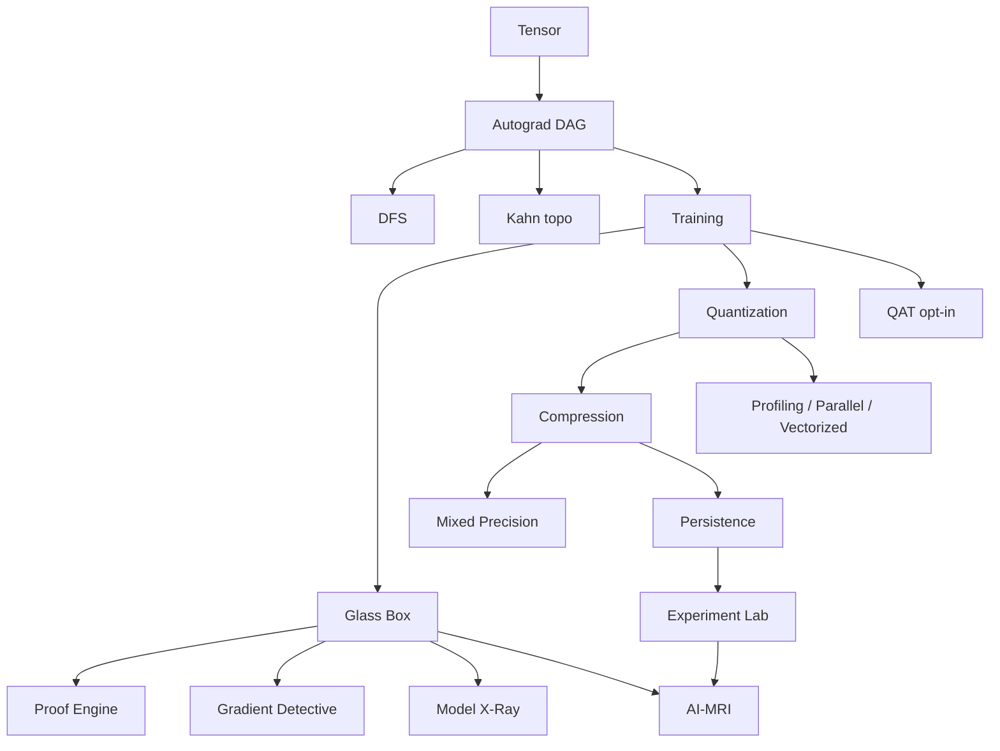

<div align="center">

```text
 __  __   ___   _   _   ___   _____    ___    ____     ____   _   _
|  \/  | |_ _| | \ | | |_ _| |_   _|  / _ \  |  _ \   / ___| | | | |
| |\/| |  | |  |  \| |  | |    | |   | | | | | |_) | | |     | |_| |
| |  | |  | |  | |\  |  | |    | |   | |_| | |  _ <  | |___  |  _  |
|_|  |_| |___| |_| \_| |___|   |_|    \___/  |_| \_\  \____| |_| |_|

                    G L A S S   B O X   A I
```

# MiniTorch

**Build it. Measure it. Explain it. Compare it. Preserve the evidence.**

An educational autodiff framework where the computational graph, the DSA, the gradients,
and the compression tradeoffs stay inspectable.

[](https://www.python.org/)
[](https://numpy.org/)
[](tests/)
[](LICENSE)
[](docs/final_report.md)

[Quickstart](#quickstart) · [Architecture](ARCHITECTURE.md) · [Final report](docs/final_report.md) · [Contributing](CONTRIBUTING.md)

</div>

---

MiniTorch is **not** a PyTorch replacement. It is a laboratory:

```text
same model  +  same data  +  same seed  +  one technique change
=  a comparison you can defend
```

---

## How the system fits together



---

## Feature matrix

| Layer | What you can inspect | Entry points |
| --- | --- | --- |
| **DSA** | DAG, DFS, Kahn topo, heap Top-K, HashMap registry | [`docs/dsa.md`](docs/dsa.md) |
| **Autograd** | Reverse-mode AD, lineage, `gradcheck` | [`docs/autograd.md`](docs/autograd.md) |
| **Glass Box** | Proof, Explorer, Detective, X-Ray, MRI | [`docs/explain.md`](docs/explain.md) |
| **Training** | `Module`, SGD/Adam, `Trainer`, checkpoints | [`docs/phase_d.md`](docs/phase_d.md) |
| **Quantization** | Uniform, codebook, packing, rotation | [`docs/phase_e.md`](docs/phase_e.md)–[`H`](docs/phase_h.md) |
| **Compression** | Post-training + mixed precision | [`docs/phase_i.md`](docs/phase_i.md), [`Q`](docs/phase_q.md) |
| **QAT** | Weight-only fake quant + STE (experimental) | [`docs/phase_o.md`](docs/phase_o.md) |
| **Performance** | Profiler, parallel, vectorized kernels | [`docs/phase_j.md`](docs/phase_j.md)–[`L`](docs/phase_l.md) |
| **Persistence** | Versioned `.mtc` artifacts + CRC32 | [`docs/phase_m.md`](docs/phase_m.md) |
| **Experiment Lab** | Deterministic IDs, comparisons, JSON results | [`docs/phase_r.md`](docs/phase_r.md) |

---

## Quickstart

```bash
python -m pip install -e ".[dev]"
pytest tests/ -q
```

```python
from minitorch import Linear, MSELoss, SGD, Sequential, ReLU, Tensor, Trainer

model = Sequential(Linear(1, 8), ReLU(), Linear(8, 1))
x = Tensor([[0.2], [0.5], [0.8]])
y = Tensor([[2.6], [3.5], [4.4]])

trainer = Trainer(model, SGD(model.parameters(), lr=0.1), MSELoss().forward)
trainer.fit(x, y, epochs=40)

loss = MSELoss().forward(model(x), y)
loss.backward()

print(loss.explain(model.parameter("0.weight")))
print(model.gradient_report())
print(model.mri(output=loss))
```

More walkthroughs: [`examples/glass_box_demo.py`](examples/glass_box_demo.py) · [`examples/train_demo.py`](examples/train_demo.py) · [`examples/final_evaluation.py`](examples/final_evaluation.py)

---

<details>
<summary><strong>How it works</strong></summary>

<br/>

Forward ops parent-link into a DAG. Backward uses Kahn topological order.
Proof replay uses the same local rules. MRI composes existing reports; it does
not invent a second compression algorithm.

```text
forward  ->  Tensor.parents  ->  ComputationGraph
         ->  backward        ->  Tensor.grad
         ->  explain / explore / gradient_report / xray / mri
         ->  Experiment Lab  ->  measure, compare, persist
```

See [`ARCHITECTURE.md`](ARCHITECTURE.md) and [`docs/architecture.md`](docs/architecture.md).

</details>

<details>
<summary><strong>What we measured</strong> (Phase S, scoped to one workload)</summary>

<br/>

Canonical setup: `Sequential(Linear(1,8), ReLU, Linear(8,1))`, `y = 3x + 2`, seed 42.
Full numbers live in [`docs/final_report.md`](docs/final_report.md).

| Question | Observed in that benchmark |
| --- | --- |
| Codebook vs uniform 4-bit | Lower output RMSE on the tiny model |
| Codebook storage | Overhead can **expand** bytes on small models |
| Bit packing | Same reconstruction; smaller physical storage |
| Rotation | Unchanged on the measured `0.weight` cases |
| Mixed precision | Better error than global 4-bit in that run |
| QAT | Reduced quantization damage in that run |
| Graph optimizer | No node removal on Linear-only graph; slower backward |
| Parallel compress | Overhead dominated on the tiny workload |
| Vectorized packing | Faster than the reference kernel at n=64 and n=256 |

These are **not** universal claims. Re-run:

```bash
python -m benchmarks --fast
```

</details>

<details>
<summary><strong>Examples</strong></summary>

<br/>

| Topic | Script |
| --- | --- |
| Glass Box | [`examples/glass_box_demo.py`](examples/glass_box_demo.py) |
| Training | [`examples/train_demo.py`](examples/train_demo.py) |
| Quantization | [`examples/quantization_demo.py`](examples/quantization_demo.py) |
| Codebooks | [`examples/codebook_demo.py`](examples/codebook_demo.py) |
| Bit packing | [`examples/bitpacking_demo.py`](examples/bitpacking_demo.py) |
| Rotation | [`examples/rotation_quantization_demo.py`](examples/rotation_quantization_demo.py) |
| Compression | [`examples/model_compression_demo.py`](examples/model_compression_demo.py) |
| QAT | [`examples/qat_demo.py`](examples/qat_demo.py) |
| Mixed precision | [`examples/mixed_precision_demo.py`](examples/mixed_precision_demo.py) |
| Experiment Lab | [`examples/experiment_lab_demo.py`](examples/experiment_lab_demo.py) |
| Final evaluation | [`examples/final_evaluation.py`](examples/final_evaluation.py) |

</details>

<details>
<summary><strong>Phase map A-S</strong></summary>

<br/>

Core through Phase S is **complete**. Later ideas are optional tracks, not a mandatory Phase T.

| Phase | Focus | Doc |
| --- | --- | --- |
| A | DSA engine | [`docs/phase_a.md`](docs/phase_a.md) |
| B | Glass Box intelligence | [`docs/phase_b.md`](docs/phase_b.md) |
| C | Graph optimizer | [`docs/phase_c.md`](docs/phase_c.md) |
| D | Training | [`docs/phase_d.md`](docs/phase_d.md) |
| E–H | Quantize, codebook, pack, rotate | [`docs/phase_e.md`](docs/phase_e.md) |
| I | Model compression | [`docs/phase_i.md`](docs/phase_i.md) |
| J–L | Profile, parallel, vectorize | [`docs/phase_j.md`](docs/phase_j.md) |
| M–N | Persistence, checkpoints | [`docs/phase_m.md`](docs/phase_m.md) |
| O–Q | QAT, MRI, mixed precision | [`docs/phase_o.md`](docs/phase_o.md) |
| R–S | Experiment Lab, validation | [`docs/phase_r.md`](docs/phase_r.md), [`docs/phase_s.md`](docs/phase_s.md) |

</details>

---

## Status

| | |
| --- | --- |
| **Implemented** | Autograd, training, Glass Box, quantization, compression, mixed precision, Experiment Lab |
| **Experimental / opt-in** | Weight-only QAT |
| **Not implemented** | GPU, distributed training, mixed-precision QAT, activation quantization, cloud tracking |

MiniTorch does **not** claim production readiness, PyTorch-beating speed, or globally optimal compression.

---

## Docs

- [`ARCHITECTURE.md`](ARCHITECTURE.md) — system overview
- [`docs/architecture.md`](docs/architecture.md) — package layout
- [`docs/final_report.md`](docs/final_report.md) — measured findings
- [`docs/future.md`](docs/future.md) — optional research tracks
- [`CONTRIBUTING.md`](CONTRIBUTING.md) · [`SECURITY.md`](SECURITY.md) · [`CHANGELOG.md`](CHANGELOG.md)

---

<div align="center">

**425 tests · NumPy backend · local educational system**

</div>
